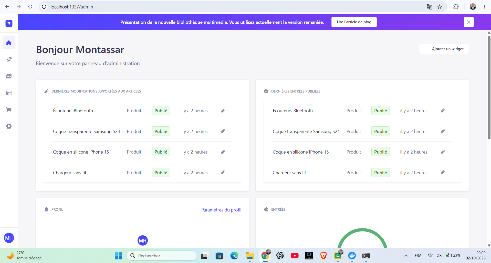

# Headless CMS Platform — Strapi 5 & Next.js

A containerized headless CMS application built with **Strapi 5**, **Next.js 16**, **React 19**, **TypeScript**, and **Docker Compose**.

This project demonstrates a decoupled architecture where Strapi manages content through a REST API, while Next.js provides the frontend interface.

## Architecture

The application consists of two independent services:

- **Backend — Strapi 5:** Headless CMS responsible for content management and API delivery.
- **Frontend — Next.js:** React-based application consuming the Strapi API.

Docker Compose orchestrates both services and manages their startup dependencies.

```text
                 User Browser
                      |
                      | HTTP
                      v
              Next.js Frontend
                Port 3000
                      |
                      | Internal Docker network
                      | API_INTERNAL_URL
                      v
                Strapi Backend
                  Port 1337
                      |
                SQLite Database
                      |
                Persistent Volume
```

## Technologies

| Component | Technologies |
|---|---|
| Backend | Strapi 5, Node.js 22 |
| Frontend | Next.js 16, React 19 |
| Language | TypeScript, JavaScript |
| Styling | Tailwind CSS 4 |
| Database | SQLite |
| Containerization | Docker, Docker Compose |

## Project Structure

```text
tp-headless/
├── backend-accessoires/
│   ├── Dockerfile
│   └── ...
├── frontend-vitrine/
│   ├── Dockerfile
│   └── ...
├── captures/
├── docker-compose.yml
├── .env.example
└── .gitignore
```

## Prerequisites

- Docker Engine
- Docker Compose
- Git

Node.js is not required on the host machine because both applications run inside Docker containers.

## Installation

### 1. Clone the repository

```bash
git clone https://github.com/MontassarHannachi/tp-headless.git
cd tp-headless
```

### 2. Configure environment variables

Copy the example configuration:

```bash
cp .env.example .env
```

Default configuration:

```env
NEXT_PUBLIC_API_URL=http://localhost:1337
FRONTEND_PORT=3000
```

### 3. Build and start the services

```bash
docker compose up -d --build
```

Check the containers:

```bash
docker compose ps
```

View application logs:

```bash
docker compose logs -f
```

## Access the applications
The Strapi administration account must be created through the initial setup interface.

| Service | URL |
|---|---|
| Next.js Frontend | http://localhost:3000 |
| Strapi Admin Panel | http://localhost:1337/admin |
| Strapi Health Check | http://localhost:1337/_health |


## Screenshots

### Strapi Administration Dashboard


## Docker Configuration

### Backend

The Strapi container:

- Uses Node.js 22.
- Installs dependencies using `npm ci`.
- Builds the Strapi application.
- Runs in production mode.
- Uses SQLite for data storage.
- Persists database files and uploaded media through Docker bind mounts.

### Frontend

The Next.js container:

- Uses Node.js 22.
- Installs dependencies using `npm ci`.
- Receives `NEXT_PUBLIC_API_URL` as a build argument.
- Builds the application using `next build`.
- Runs using `next start`.

### Service Health and Dependencies

The backend includes a Docker healthcheck targeting:

```text
http://localhost:1337/_health
```

The frontend uses:

```yaml
depends_on:
  strapi:
    condition: service_healthy
```

This ensures that the frontend starts only after Strapi passes its healthcheck.

## Environment Configuration

| Variable | Description |
|---|---|
| `NEXT_PUBLIC_API_URL` | Public URL used by the frontend to access the Strapi API |
| `FRONTEND_PORT` | Host port exposed by the Next.js container |

The frontend also uses `API_INTERNAL_URL=http://strapi:1337` to communicate with Strapi through the internal Docker network.

## Useful Docker Commands

Stop the services:

```bash
docker compose down
```

Rebuild the applications:

```bash
docker compose up -d --build
```

Follow backend logs:

```bash
docker compose logs -f strapi
```

Follow frontend logs:

```bash
docker compose logs -f frontend
```

Check backend health:

```bash
docker inspect strapi
```

## Data Persistence

The Strapi service uses persistent bind mounts:

- `backend-accessoires/.tmp` for SQLite database files.
- `backend-accessoires/public/uploads` for uploaded media.

These directories preserve application data when containers are recreated.

**Important:** `docker compose down` does not remove these host directories. However, deleting them manually will remove the corresponding persisted data. Backups should be performed regularly.

## Project Objectives

This project explores:

- Headless CMS architecture.
- Frontend/backend separation.
- REST API integration.
- Docker image construction.
- Multi-container orchestration.
- Environment-based configuration.
- Container healthchecks and service dependencies.
- Persistent application data.

## Author

**Montassar Hannachi**

GitHub: [MontassarHannachi](https://github.com/MontassarHannachi)
