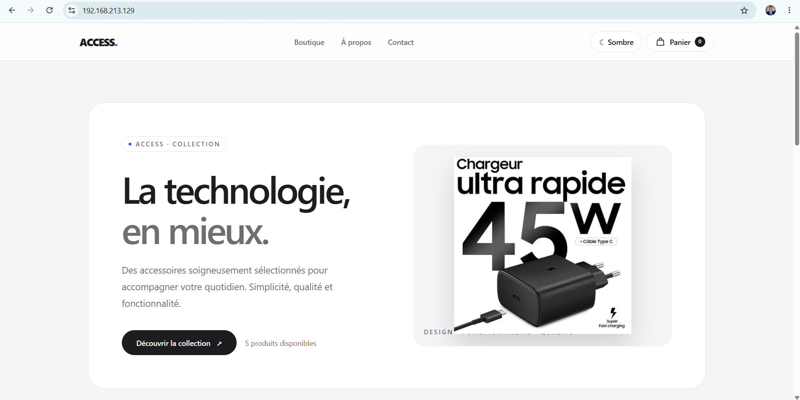
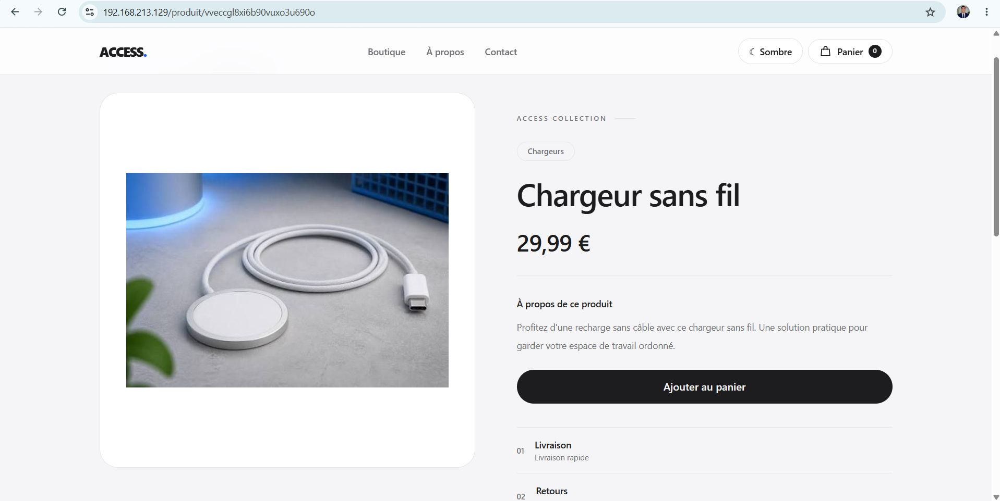
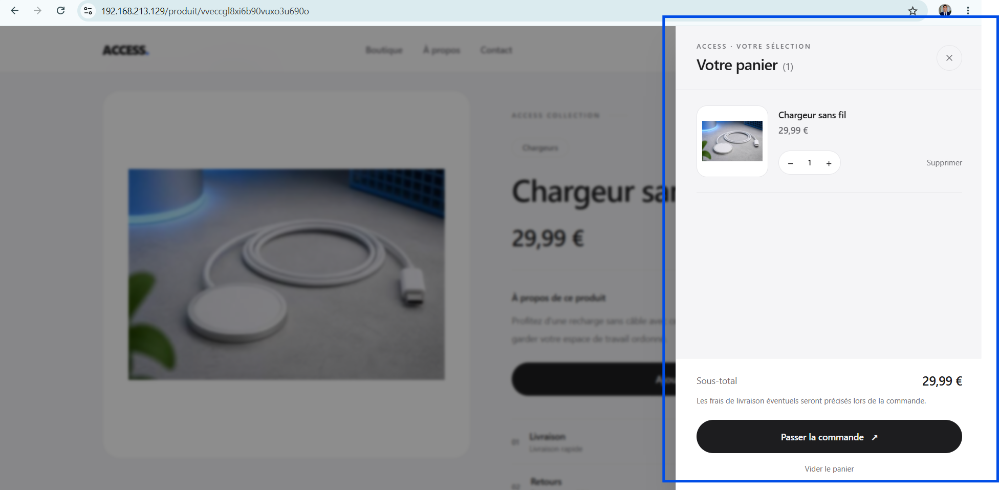
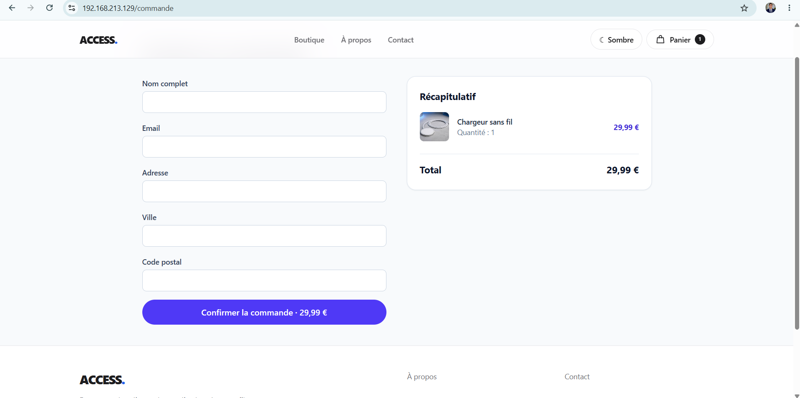

# Headless Commerce
### Plateforme e-commerce moderne · Strapi 5 × Next.js 16

<p align="center">
  
  
  
  
  
  
</p>

<p align="center">
  Application e-commerce Full-Stack basée sur une architecture Headless, développée avec Next.js et Strapi, conteneurisée avec Docker et sécurisée par HTTPS.
</p>

---

## 1. Présentation du projet

**Headless Commerce** est une application e-commerce Full-Stack développée autour d'une architecture Headless CMS.

Le projet repose sur une séparation entre le frontend, responsable de l'affichage et de l'expérience utilisateur, et le backend, chargé de la gestion des produits, des contenus et des opérations métier.

Le frontend est développé avec **Next.js 16**, tandis que **Strapi 5** assure la gestion du contenu et expose les API nécessaires au fonctionnement de l'application.

L'ensemble de l'environnement est conteneurisé avec Docker Compose et accessible via un reverse proxy Nginx configuré en HTTPS pour une utilisation sur un réseau local.

## 2. Captures d'écran

### Page d'accueil



### Fiche produit



### Panier



### Commande



## 3. Fonctionnalités principales

### Interface utilisateur
- Interface e-commerce responsive.
- Catalogue de produits.
- Pages détaillées des produits.
- Affichage des images et descriptions.
- Gestion du panier.
- Formulaire de commande.
- Formulaire de contact.
- Pages informatives et de confiance.

### Backend et gestion des données
- CMS Headless Strapi 5.
- API REST pour la gestion des produits et des contenus.
- Création et gestion des commandes.
- Traitement des formulaires de contact.
- Calcul des prix côté serveur.
- Validation des requêtes.
- Protection contre les commandes en double grâce à l'idempotence.

### Infrastructure et sécurité
- Architecture multi-conteneurs avec Docker Compose.
- Reverse proxy Nginx.
- HTTPS local avec mkcert.
- Redirection automatique HTTP vers HTTPS.
- En-têtes HTTP de sécurité.
- Persistance des données avec SQLite.
- Protection des opérations API sensibles par un secret côté serveur.

## 4. Technologies utilisées

| Technologie | Utilisation |
|---|---|
| Next.js 16 | Développement du frontend |
| React 19 | Interface utilisateur |
| TypeScript | Développement typé |
| Strapi 5 | CMS Headless et backend |
| SQLite | Base de données |
| Docker | Conteneurisation |
| Docker Compose | Orchestration des services |
| Nginx | Reverse proxy et gestion HTTPS |
| mkcert | Génération de certificats TLS locaux |
| Ubuntu | Environnement de déploiement |

## 5. Architecture technique

```text
                 Navigateur utilisateur
                          |
                          | HTTPS :443
                          v
                    +-----------+
                    |   Nginx   |
                    |  Reverse  |
                    |   Proxy   |
                    +-----------+
                          |
                          | HTTP
                          v
                    +-----------+
                    |  Next.js  |
                    | Frontend  |
                    +-----------+
                          |
                          | HTTP interne
                          v
                    +-----------+
                    |  Strapi   |
                    | Backend   |
                    +-----------+
                          |
                          v
                    +-----------+
                    |  SQLite   |
                    | Base de   |
                    | données   |
                    +-----------+
```

### Configuration réseau

| Service | Port | Accès |
|---|---:|---|
| Nginx | 80 / 443 | Réseau local |
| Next.js | 3000 | Réseau Docker interne |
| Strapi | 1337 | Localhost et réseau Docker |
| SQLite | — | Stockage persistant |

Nginx constitue le point d'entrée des requêtes provenant du navigateur.

La connexion HTTPS est terminée au niveau de Nginx, qui transmet ensuite les requêtes au frontend Next.js.

Le frontend communique avec Strapi à travers le réseau interne Docker.

## 6. Routes API

L'application Next.js utilise des routes API côté serveur pour gérer certaines opérations sensibles.

| Endpoint | Méthode | Description |
|---|---|---|
| `/api/checkout` | POST | Création d'une commande |
| `/api/contact` | POST | Traitement du formulaire de contact |
| `/api/media/[...path]` | GET | Proxy des fichiers médias |

Le processus de commande comprend :
- La validation des données reçues.
- Le calcul des prix côté serveur.
- La vérification de la requête.
- La protection contre les soumissions répétées grâce à une clé d'idempotence.

## 7. Structure du projet

```text
tp-headless/
│
├── backend-accessoires/
│   ├── config/
│   ├── src/
│   ├── public/
│   └── .tmp/
│
├── frontend-vitrine/
│   ├── app/
│   │   ├── api/
│   │   ├── components/
│   │   └── ...
│   ├── public/
│   └── package.json
│
├── docs/
│   └── captures/
│       ├── vitrine.png
│       ├── produit.png
│       ├── panier.png
│       └── commande.png
│
├── nginx/
│   └── default.conf
│
├── certs/
│
├── docker-compose.yml
├── .env
├── .gitignore
└── README.md
```

Les fichiers d'environnement contenant des informations sensibles et les clés privées TLS ne doivent jamais être publiés sur GitHub.

## 8. Installation et déploiement

### Prérequis

- Ubuntu Linux.
- Docker Engine.
- Plugin Docker Compose.
- Git.
- mkcert.

### Cloner le dépôt GitHub

```bash
git clone https://github.com/MontassarHannachi/tp-headless.git

cd tp-headless
```

### Configuration des variables d'environnement

Créer le fichier `.env` à la racine du projet :

```env
NEXT_PUBLIC_API_URL=https://YOUR_HOST_IP
STORE_API_SECRET=YOUR_GENERATED_SECRET
```

Configurer également le fichier `backend-accessoires/.env` avec les variables nécessaires au fonctionnement de Strapi.

**Important :** les valeurs ci-dessus sont des exemples. Il faut utiliser ses propres paramètres et ne jamais publier les fichiers `.env` contenant des secrets.

### Génération des certificats HTTPS locaux

Installer mkcert :

```bash
sudo apt install mkcert
```

Initialiser l'autorité de certification locale :

```bash
mkcert -install
```

Créer le dossier des certificats :

```bash
mkdir -p certs
```

Générer un certificat pour l'adresse IP locale de la machine Ubuntu :

```bash
mkcert \
  -cert-file certs/local-cert.pem \
  -key-file certs/local-key.pem \
  YOUR_HOST_IP
```

Protéger la clé privée :

```bash
chmod 600 certs/local-key.pem
```

Le certificat racine public doit être installé sur les appareils clients qui doivent faire confiance à la connexion HTTPS locale.

### Construction et démarrage des conteneurs

Construire et démarrer les services :

```bash
docker compose up -d --build
```

Vérifier l'état des conteneurs :

```bash
docker compose ps
```

Consulter les journaux :

```bash
docker compose logs -f
```

## 9. Accès à l'application

Depuis un navigateur connecté au réseau local, accéder à :

```text
https://YOUR_HOST_IP
```

Les requêtes HTTP sont automatiquement redirigées vers HTTPS.

### Accès à l'administration Strapi

Le service Strapi n'est pas directement exposé au réseau local.

Pour accéder à son interface d'administration depuis un poste autorisé, créer un tunnel SSH :

```bash
ssh -L 1337:127.0.0.1:1337 USER@YOUR_HOST_IP
```

Puis ouvrir dans le navigateur :

```text
http://localhost:1337/admin
```

## 10. Persistance des données

Les montages Docker permettent de conserver les données en dehors du cycle de vie des conteneurs.

La base de données SQLite est stockée dans :

```text
backend-accessoires/.tmp/data.db
```

Les fichiers médias téléversés sont conservés dans :

```text
backend-accessoires/public/uploads/
```

La reconstruction des conteneurs ne nécessite pas la suppression de ces répertoires persistants.

## 11. Commandes Docker utiles

Démarrer les services :

```bash
docker compose up -d
```

Reconstruire les services :

```bash
docker compose up -d --build
```

Arrêter les services :

```bash
docker compose down
```

Afficher les conteneurs actifs :

```bash
docker compose ps
```

Consulter les journaux :

```bash
docker compose logs -f
```

Redémarrer les services :

```bash
docker compose restart
```

## 12. Sécurité

Le projet intègre plusieurs mécanismes de sécurité :

- Connexion HTTPS via Nginx.
- Redirection automatique HTTP vers HTTPS.
- Utilisation de TLS 1.2 et TLS 1.3.
- En-têtes HTTP de sécurité.
- Isolation du backend dans le réseau Docker.
- Validation des requêtes de commande côté serveur.
- Calcul des prix côté serveur.
- Protection des opérations API internes.
- Protection contre les soumissions de commandes en double.
- Gestion des secrets par variables d'environnement.

### Limites du déploiement HTTPS

Les certificats générés avec mkcert sont destinés au développement et aux réseaux locaux de confiance.

Ils ne sont pas reconnus publiquement par défaut. Les appareils clients doivent faire confiance à l'autorité de certification locale.

Un déploiement public en production nécessiterait notamment :
- Un nom de domaine.
- Un certificat TLS reconnu publiquement.
- Une configuration réseau adaptée.
- Des sauvegardes régulières.
- Une supervision et des mesures de sécurité supplémentaires.

## 13. Améliorations futures

Plusieurs évolutions peuvent être envisagées :

- Intégration d'une passerelle de paiement en ligne.
- Mise en place de tests automatisés.
- Recherche de produits et filtres avancés.
- Authentification et gestion des comptes clients.
- Suivi des commandes.
- Déploiement en production avec un domaine public.
- Sauvegardes automatiques et supervision.
- Mise en place d'un pipeline CI/CD.

## 14. Compétences développées

Ce projet permet de mettre en pratique plusieurs compétences techniques :

- Architecture Headless CMS.
- Développement Full-Stack.
- Intégration d'API REST.
- Communication entre Next.js et Strapi.
- Conteneurisation avec Docker.
- Orchestration avec Docker Compose.
- Configuration d'un reverse proxy Nginx.
- Gestion des certificats HTTPS et TLS.
- Gestion des variables d'environnement.
- Validation backend et sécurité API.
- Persistance des données applicatives.

---

## Auteur

**Montassar Hannachi**

- GitHub : [MontassarHannachi](https://github.com/MontassarHannachi)
- Dépôt du projet : [tp-headless](https://github.com/MontassarHannachi/tp-headless)

---

<p align="center">
  Développé avec Next.js, Strapi, Docker et Nginx.
</p>
